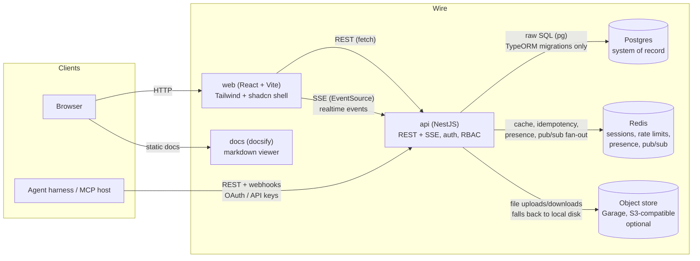

# Wire

Wire is an **API-first**, **AI-native** team messaging platform. Humans, software services, and **agents** collaborate in shared workspaces through channels, threads, and structured artifacts. The contract for the system is the [OpenAPI specification](./internal-docs/api/openapi.yaml), **generated** from the running API's `@nestjs/swagger` decorators and never hand-edited: clients, MCP servers, and agent harnesses are peers that consume the same surface.

[](https://react.dev)
[](https://www.typescriptlang.org)
[](https://vite.dev)
[](https://nestjs.com)
[](https://www.postgresql.org)
[](https://redis.io)
[](https://www.docker.com)
[](https://bun.sh)
[](https://turborepo.com)

## Principles

| Principle               | Meaning                                                                                         |
| ----------------------- | ----------------------------------------------------------------------------------------------- |
| API-first               | Every capability exists in the HTTP API before any UI.                                          |
| Agents as actors        | Agents have identity, permissions, presence, and audit trails like human members.               |
| Harness-neutral         | Claude, Cursor, custom SDKs, and cron workers integrate via OAuth, API keys, MCP, and webhooks. |
| Import-first onboarding | **Slack admin export** is the primary way to capture users and backdated history.               |
| Retrieval-native        | Messages and files are indexed for semantic search, citation, and agent context assembly.       |
| Automations as code     | Triggers, filters, and actions are declarative and versioned; agents can author and run them.   |
| MCP as distribution     | A standard MCP server exposes Wire tools to any MCP-capable host.                               |

## Architecture



`packages/ui` ships as a design-system package (`@wire/ui`), consumed by `web` and previewed in Storybook; it has no runtime service of its own. See [internal-docs/stack/architecture.md](./internal-docs/stack/architecture.md) for the full target architecture, including the planned `worker` and `mcp-server` services not yet built.

## Setup

**Requires:** [Bun](https://bun.sh) 1.1+ and Docker (for Postgres and Redis only; apps run natively).

```bash
make setup   # once: bun install + .env files from .env.example
make dev     # Postgres + Redis in Docker, migrations, seed, then api + web + docs + storybook
```

### Local services

| Service                | URL                                                      |
| ---------------------- | -------------------------------------------------------- |
| Web app                | [http://localhost:5173](http://localhost:5173)           |
| API                    | [http://localhost:3001](http://localhost:3001)           |
| API docs (OpenAPI UI)  | [http://localhost:3001/docs](http://localhost:3001/docs) |
| Markdown docs          | [http://localhost:3000](http://localhost:3000)           |
| Storybook (`@wire/ui`) | [http://localhost:6006](http://localhost:6006)           |

Run `make help` for every target, including `make dev-api`, `make dev-web`, `make dev-storybook` to run a single app, and `make docker-up` to run the whole stack in containers instead (no hot reload).

### Checks

```bash
bun run typecheck   # turbo run typecheck, cached
bun run lint        # Biome + wire-rules eslint + generated-file checks + markdown lint
bun run test        # turbo run test, cached
```

## Quick integration paths

0. **Onboard from Slack**: upload an admin export zip to `POST /workspaces/from-import`, users claim accounts, and agents/search see backdated history ([import/workspace-import.md](./internal-docs/import/workspace-import.md)).
1. **REST + webhooks**: provision an app, subscribe to events, post messages, and run agent turns via `/v1`.
2. **MCP**: point a host at `wire-mcp`, authenticate with workspace-scoped tokens, and call tools (`search`, `post_message`, `run_agent`, etc.).
3. **Agent harness**: register an `Agent` resource, attach a `Harness` (model + tools + system prompt template), and invoke `POST /v1/agent-runs`.
