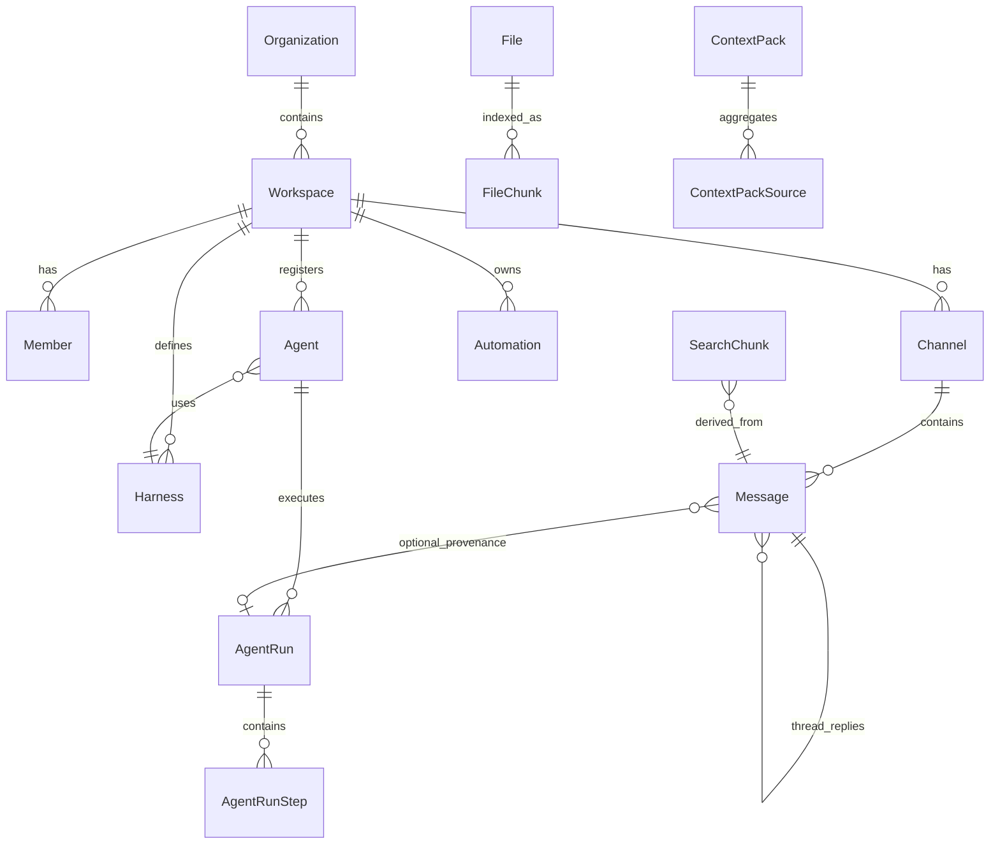

# Data model

## Entity relationship (logical)

## Key tables (implementation-agnostic)

### workspaces

| Column      | Type   | Notes                     |
| ----------- | ------ | ------------------------- |
| id          | string | `ws_`                     |
| org_id      | string |                           |
| name        | string |                           |
| data_region | string |                           |
| policies    | jsonb  | retention, DLP, approvals |

### agents

| Column            | Type   | Notes                   |
| ----------------- | ------ | ----------------------- |
| id                | string | `agt_`                  |
| workspace_id      | string | FK                      |
| handle            | string | unique per workspace    |
| harness_id        | string | FK                      |
| permission_set_id | string |                         |
| status            | enum   | active, paused, deleted |

### agent_runs

| Column          | Type   | Notes    |
| --------------- | ------ | -------- |
| id              | string | `run_`   |
| agent_id        | string |          |
| trigger_type    | string |          |
| status          | enum   |          |
| context_pack_id | string | nullable |
| parent_run_id   | string | nullable |

### messages

| Column         | Type   | Notes                |
| -------------- | ------ | -------------------- |
| id             | string | `msg_`               |
| channel_id     | string |                      |
| thread_root_id | string | nullable             |
| actor_id       | string | member or agent      |
| actor_type     | enum   | human, agent, system |
| agent_run_id   | string | nullable             |
| body           | jsonb  |                      |
| revision       | int    |                      |

### automations

| Column       | Type   | Notes                       |
| ------------ | ------ | --------------------------- |
| id           | string | `aut_`                      |
| workspace_id | string |                             |
| version      | int    | monotonic                   |
| definition   | jsonb  | trigger, condition, actions |
| enabled      | bool   |                             |

### search_chunks

| Column          | Type     | Notes         |
| --------------- | -------- | ------------- |
| id              | string   | `chk_`        |
| workspace_id    | string   |               |
| source_type     | enum     | message, file |
| source_id       | string   |               |
| acl_channel_ids | string[] |               |
| embedding       | vector   |               |
| text            | text     |               |

## Soft delete

`deleted_at` on messages (tombstone), channels, agents. Search excludes unless `include_deleted` admin flag.

## Consistency

- Message create → event → index job (eventual, target &lt; 5s P95).
- Agent run state transitions linearizable per `run_id`.

## External id mapping

Apps may attach `external_id` on messages and agents for bi-directional sync; unique per `(workspace_id, app_id, external_id)`.

### import_mappings

Persistent map from Slack (or other) ids created during [workspace import](../import/workspace-import.md):

| Column        | Type   | Notes                               |
| ------------- | ------ | ----------------------------------- |
| import_id     | string | `imp_`                              |
| resource_type | enum   | member, channel, message, file      |
| source_system | string | `slack`                             |
| source_id     | string | e.g. `U0123`, `C0456`, message `ts` |
| wire_id       | string | Target resource                     |
| workspace_id  | string | FK                                  |

Unique on `(workspace_id, source_system, resource_type, source_id)`.

### Temporal columns on messages

| Column            | Notes                          |
| ----------------- | ------------------------------ |
| source_created_at | Slack `ts`; drives sort/search |
| created_at        | Same as source for imports     |
| imported_at       | Ingestion wall time            |
